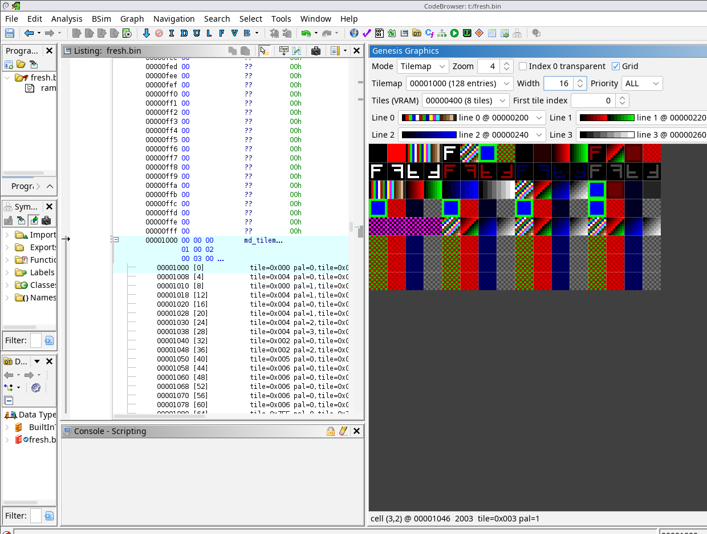

# ghidra-genesis-gfx

Ghidra extension for Mega Drive / Genesis graphics. Select bytes in the listing, right-click
**Genesis**, and define them as:

- **CRAM palette**: `md_color[16 * n]`, 9-bit BGR words (`0000 BBB0 GGG0 RRR0`)
- **VRAM tiles**: `md_tile_4bpp[n]`, 8x8 at 4 bpp, 32 bytes per tile
- **Tilemap**: `md_tilemap_entry[n]`, priority, palette line, vflip, hflip, 11-bit tile index

With no selection you are asked for a count at the cursor. Each element shows its decoded value in
the listing.

The **Genesis Graphics** window (Window menu) previews what is defined. Tiles mode draws a tile set
with any defined palette line as CRAM. Tilemap mode draws a tilemap with a defined tile set as VRAM
(with an adjustable first tile index) and any four palette lines as CRAM lines 0-3. It can filter by
priority and show index 0 as transparent. It follows the listing cursor, shows the entry under the
mouse, and jumps to it on double click.



## Install

Download a release zip, or build one:

```
GHIDRA_INSTALL_DIR=/path/to/ghidra ./gradlew buildExtension
```

Then **File > Install Extensions**, add `dist/*.zip`, restart, and enable `GenesisGfxPlugin` in the
CodeBrowser (**File > Configure > Miscellaneous**). Built and tested against Ghidra 12.1.2 with JDK 21.

`ghidra_scripts/GenesisGfxExport.java` defines and exports the same images as PNGs headless.
`src/test/headless/run.sh` builds a synthetic ROM, runs the extension headless and compares every
rendered pixel against an independent Python decoder.

Colour channels expand 3 bits to 8 linearly (`v * 255 / 7`).

## License

MIT
